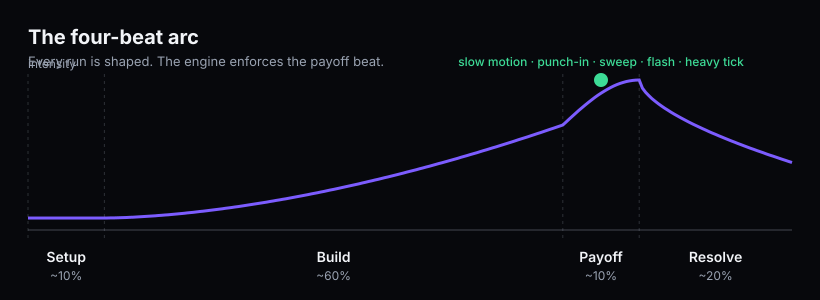
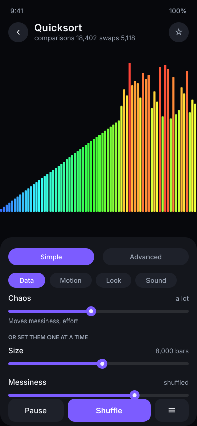
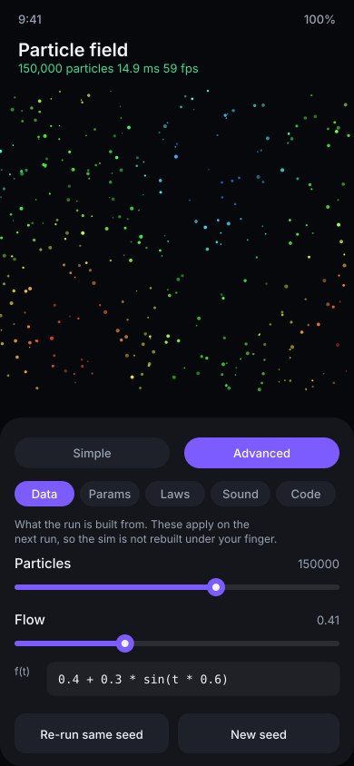
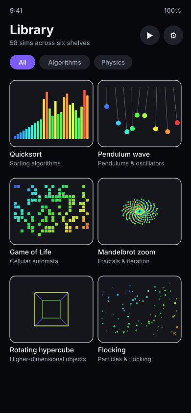
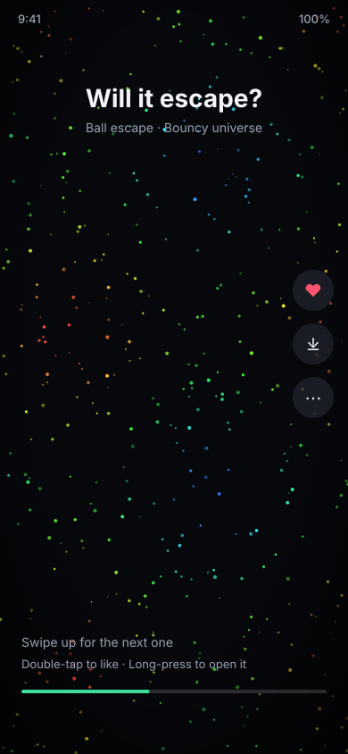
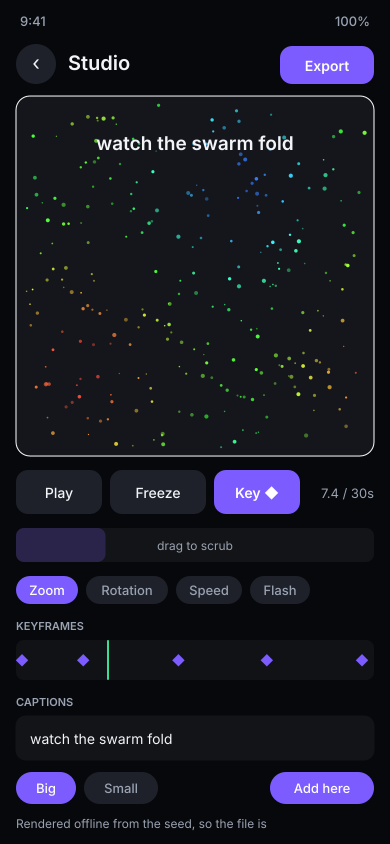

# The Hypnotica bible

Everything here is enforced in code or checked on the phone. When two rules
conflict, the lower-numbered principle wins. If the code and this file disagree,
one of them is a bug — say which.

- [Ten principles](#ten-principles)
- [The four-beat arc](#the-four-beat-arc)
- [Motion craft](#motion-craft)
- [The screens](#the-screens)
- [The control model](#the-control-model)
- [Changing the laws](#changing-the-laws)
- [TickTock](#ticktock)
- [Studio](#studio)
- [Tokens](#tokens)
- [Scale](#scale)
- [Accessibility and safety](#accessibility-and-safety)
- [The satisfaction checklist](#the-satisfaction-checklist)

## Ten principles

1. **The sim is the interface.** The simulation fills the screen; UI floats over
   it and fades after about 2.6 s with no touch. Never shrink a sim to fit chrome
   unless controls were asked for.
2. **Motion before menus.** Every entry point shows moving content within one
   second. No loading screens, no splash. Even the Library cards are the sims
   themselves, simulated for a moment and painted.
3. **Every event is seen, heard and felt.** A collision, swap or birth gets a
   visual accent, a note and — for the kinds worth feeling — a haptic tick, on
   the same frame.
4. **Satisfaction is designed, not hoped for.** Every sim ships with a scripted
   arc and must pass the checklist at the end of this file. A sim with no payoff
   fails the build, not a review.
5. **Plain words, real math.** Labels say "Messiness", not `entropy_coeff`. The
   maths underneath stays honest and is one tab away.
6. **One gesture, one meaning.** Tap shows controls, double-tap likes, long-press
   opens more, pinch zooms, twist rotates, two-finger drag pans. The same
   everywhere.
7. **Nothing breaks the loop.** No modal dialogs over a running sim, no spinners,
   no sound cutting mid-note.
8. **Dark canvas, bright content.** Near-black background; colour is reserved for
   the simulation.
9. **Deterministic and shareable.** Any frame is reproducible from recipe, seed
   and parameters. This is what makes the payoff pre-check and the offline
   renderer possible.
10. **60 fps or it does not ship.** A sim that drops frames on the reference
    phone gets simplified until it does not.

## The four-beat arc



| Beat | Share of a run | What happens |
| --- | --- | --- |
| Setup | ~10% | Clean, calm start; the goal is obvious at a glance |
| Build | ~60% | Steady escalation: more, faster, higher, brighter |
| Payoff | ~10% | The moment — a snap, an escape, a completion |
| Resolve | ~20% | Settle and breathe; the last frame is worth a screenshot |

`Sim.payoff()` returns true on the payoff frame. The engine answers with slow
motion (time drops to 0.25x and eases back over a second), a small camera
punch-in, a rising sweep from the synth, a rate-limited flash and a heavy haptic.
A sim does not implement any of that; it says *now*, and the engine performs.

## Motion craft

- Easing on everything that is not physics; nothing in the UI moves linearly.
- Trails for anything moving faster than about one screen-width a second.
- Anticipation of 100–200 ms before a big event.
- Slow motion at the payoff, ramped back in rather than snapped.
- Camera breath under 1% zoom to keep static sims alive; a 2–5% punch-in on the
  payoff, off when Reduce motion is on.
- Screen shake only on heavy impacts, 2–4 px, under 150 ms, switchable off.

**Impact juice.** On the same frame as the sound event: a brightness flash on the
object, a glow or spark burst at the contact point, a colour shift along the
palette, and a haptic tick sized to the impact.

**Completion pleasure.** The final sweep runs a success-coloured highlight the
length of a finished sort with rising notes; sorted data becomes a smooth
gradient or a clean spiral; alignment moments get a glow pulse and a chord.

## The screens

Seven screens, one running simulation. The GL surface is created once and
re-parented between screens, so switching never tears down the context or
restarts what is playing.

```
Feed  ⇄  Player  ⇄  Library  →  Settings  →  TickTock
                                         →  Studio
                                         →  Recipes
```

### Player, Simple mode



The sim fills the screen. Chrome floats and fades. The top line is the sim's
name and its live counters; the bottom is Pause, the hero button (whatever this
sim's one big action is — "Shuffle", "Drop it", "Lift and drop") and the drawer
toggle.

The drawer opens on four or five cards — Data, Motion, Look, Sound and, for a
sim that reads the laws, Laws. Each card leads with its **macros**: one slider
that moves several exact values at once. Below them, the individual sliders, in
plain words.

### Player, Advanced mode



The same sim, the same values, nothing hidden: five tabs (Data, Params, Laws,
Sound, Code), exact numbers, every `advancedOnly` parameter, the seed, and a
formula box under every numeric field that accepts an expression in `t` — so
"Flow" can be `0.4 + 0.3 * sin(t * 0.6)` instead of a number.

Simple and Advanced are two views of one state. Nothing is reset by switching.

### Library



Fifty-seven sims across six shelves, filtered by shelf, with favourites first.
Every card is a real preview: the sim is run headlessly for about a second and
its own draw list is painted onto the card. No stock art, nothing invented.

### TickTock



Reached from an unlabelled clock glyph under the version number in Settings.

### Studio



Reached from the film-strip glyph beside it.

### Settings, Feed, Recipes

Settings holds sound, look, comfort and safety, the time check, the TickTock
format switches and — unlabelled, under the version — the two hidden doors. The
Feed is a vertical swipe through the whole library, one sim per flick. Recipes is
a plain text editor over the Lua sandbox, with the parse error shown inline.

## The control model

Three layers, same underlying values:

| Layer | Who it is for | What it shows |
| --- | --- | --- |
| **Macros** | Everyone | One slider, several parameters. "How much", "Energy", "Chaos" |
| **Simple sliders** | Everyone | One parameter each, plain words, no numbers to type |
| **Advanced** | Anyone who wants it | Exact values, hidden parameters, formulas, laws, the Lua source |

Simple mode is not Advanced mode with things taken away. Every sim has at least
one macro; where a sim declares none, `Macros.forDef` derives "How much" from its
largest count parameter and "Energy" from its motion values, so a single slider
still reaches from a handful of objects to tens of thousands.

Data-card values shape what `setup()` builds, so they apply when you let go
rather than mid-drag. Everything else applies live, while it runs.

**Gestures.** Tap toggles chrome. Double-tap favourites (likes, in TickTock).
Long-press opens the drawer. Pinch zooms. Two fingers pan. A two-finger twist
rotates the whole sim. One finger reaches into the sim — or pans the view, if you
switch that on in Look.

**Record moves.** The Motion card can record what you do to a running sim —
pinches, drags, twists, speed — and hand it to Studio as keyframes, thinned down
to a few dozen you can drag afterwards rather than a thousand you cannot.

**Evolve.** Also on the Motion card: the live values drift slowly on their own,
each on its own phase, so a loop never settles into exactly the same thing twice.
A formula you typed outranks the drift; Evolve leaves it alone.

## Changing the laws

One `Laws` table is shared by every physics sim, so changing it changes all of
them at once. Fifteen presets — Our universe, Moon, Zero-G, Upside-down, Bouncy,
Sticky, Ghosts, Syrup, Slow light, Backwards time, Repulsive gravity, Negative
mass, Wrap-around space, Strong charges, Heavy & bouncy — plus the sliders and
switches behind them: gravity, bounciness, friction, time speed, time direction,
space wrapping, mass sign, charge strength, the speed of light, force falloff,
the gravitational constant, and a typed force law such as `g * m1 * m2 / r^2`.

Editing any law renames the universe "Custom" and the chip row grows a Custom
chip, so your edit is visible rather than deselecting everything.

Every field in the table is read by something. A law nothing honours is a lie in
a menu, and gets deleted rather than documented.

**Dimensions** are a separate shelf, not a law: hypercube rotation by plane,
slicing a 4D solid with a 3D knife, N-dimensional bouncing, random walks in up to
six dimensions, and the volume of an n-ball (which peaks at five dimensions and
then falls — the payoff is watching it fall).

## TickTock

An endless, generated feed, reached from the hidden clock glyph.

Every clip is **simulated through before it is shown**. The director picks a sim
and a trap format, randomises the parameters inside a watchable band, picks laws
and a palette, then runs the whole thing headlessly. If it does not reach a
payoff inside the window, the seed is thrown away and another is tried. That
pre-check is the whole difference between an endless feed and an endless feed
worth watching.

Fifteen trap formats, each with its own hook line: Will it escape?, Marble race,
Colour battle, Number go up, Chain reaction, Perfect fit, Cut crush squish, Clean
and reveal, Fill to the line, Grow and build, Song mode, Last one standing,
Perfect loop, Guess the winner, Slow build sudden snap. Every one of them is
reachable: a format no sim can produce is deleted, not listed.

Swipe up for the next clip, down to leave, double-tap to like, long-press to open
it in the player with all its controls. What you watch and what you skip is
weighted on the phone and kept between launches; formats you do not want can be
switched off in Settings, and what it has learned can be reset there.

## Studio

A video editor for the simulation, reached from the hidden film-strip glyph.

A project stores the recipe, the seed, the keyframes and the captions — never
pixels. It is a few kilobytes, replays exactly, and can be re-rendered at any
size afterwards.

- **Nine tracks**: camera x, camera y, zoom, rotation, speed, gravity,
  bounciness, trails, flash. A track with no keyframes leaves that value alone.
- **Keyframes** with seven easing curves, set from whatever the sim is doing right
  now, dragged on the strip, removed one at a time or cleared.
- **Freezes**: stretches where time stops but the camera keeps moving.
- **Captions** at the playhead, big or small, which are composited into the
  exported file as well as shown in the preview.
- **Five templates** to start from, and scrubbing that re-simulates from the seed
  rather than scrubbing a recording.
- **Export** to MP4 with the synth's audio, at 9:16, 1:1, 16:9 or a smaller 720p, rendered
  offline frame by frame so the file is smooth even if the preview is not —
  cancellable, and saved into `Movies/Hypnotica` where the gallery can see it,
  with a share sheet for everything else.

## Tokens

| Token | Value | Use |
| --- | --- | --- |
| `Bg` | `#07080C` | Canvas and app background |
| `Surface` | `#14161C` | Glass panels and drawers |
| `SurfaceStrong` | `#1E212A` | Pressed and selected |
| `TextPrimary` | `#F2F4F8` | Labels and values |
| `TextSecondary` | `#9AA3B2` | Hints, units, captions |
| `Accent` | `#7C5CFF` | Selection, active slider, hero button |
| `Success` | `#3DDC97` | Final sweep, "sorted", wins |
| `Warning` | `#FFB020` | Performance and safety notices |
| `Danger` | `#FF5470` | Destructive actions, errors, recording |

Sim palettes are hue arcs, so any two positions look right together: Spectrum
(default), Aurora, Ember, Ocean, Candy, Mono glow, Colour-safe. They are
evaluated through a 512-entry lookup table, because a palette call happens once
per object per frame — at 400,000 objects that lookup is the difference between
14 ms and 3 ms.

Type: Display 28/34, Title 20/26, Title medium 16/22, Body 15/22, Body small
13/18, Label 12/16. Counters use tabular figures so they do not jiggle.

Layout: 4 dp grid, 16 dp gutters, 8 dp between related controls and 16 dp
between groups, 48 dp minimum touch target, 52 dp primary actions. Radius 12 dp
cards, 24 dp sheets, full pill for chips.

Motion: `fast` 120 ms, `base` 200 ms, `sheet` 280 ms, `slow` 350 ms.

## Scale

"Tens of thousands" is a promise about the engine, so it is measured rather than
asserted. Per 60 Hz frame, step plus draw-list build, on a two-core CI runner —
the figures the test suite prints on every build:

| Sim | Size | Time |
| --- | --- | --- |
| Particle field | 400,000 particles | 48.6 ms |
| Game of Life | 1024 × 1024 cells | 12.2 ms |
| Quicksort | 200,000 bars | 3.5 ms |
| Bubble sort | 200,000 bars | 9.3 ms |
| Pendulum wave | 20,000 pendulums | 3.1 ms |
| N-body | 4,000 bodies | 0.9 ms |
| Rectangles under a curve | 200,000 bars | <0.1 ms |
| Binary tree | 100,000 nodes | <0.1 ms |
| Galton board | 20,000 beads | <0.1 ms |
| Lorenz attractor | 60,000 trail | <0.1 ms |

Run to run these move by a few milliseconds; they are printed fresh by every
build rather than copied from an earlier one.

A phone has more cores than that runner, so these should improve there; the
figure to trust is the one `QA.md` records on the actual device. On first launch
the app measures itself — 40,000 particles for a second — and tells the clip
generator what this phone can carry, so a modest phone gets smaller generated
clips rather than stuttering ones. The result is shown in Settings.

How it is done: one instanced draw call for shapes, a separate point-sprite path
above a few thousand objects, a 512-entry palette LUT, a fast trig approximation,
`Parallel.forRange` across cores for the big loops, no allocation in `step` or
`draw`, and ping-pong framebuffers for trails.

## Accessibility and safety

| Risk | What the engine does | What the person controls |
| --- | --- | --- |
| Photosensitive seizures | Large flashes capped at 3 a second (WCAG's general flash threshold) | "Reduce flashing" softens every flash to a quarter and tightens the cap to 1 a second |
| Loud or harsh sound | Soft limiter, loudness kept level across sims, pitch capped at 4 kHz | Volume, gentle presets, mute per event kind |
| Motion sickness | Shake and punch-in small by default | "Reduce motion" turns them off |
| Colour blindness | Palettes readable by lightness | A colour-safe palette |
| Losing an evening | — | A time check that quietly says how long you have been watching |

A recipe cannot opt out of any of this. It asks for a flash; the limiter decides.

## The satisfaction checklist

Every sim, before its round is done:

- [ ] Clear setup, build, payoff and resolve
- [ ] Every event has a matched visual, sound and haptic on the same frame
- [ ] Payoff uses at least two of: slow motion, punch-in, final sweep, chord, glow pulse
- [ ] No stutter at 60 fps on the reference phone
- [ ] Trails or blur on anything moving faster than a screen-width a second
- [ ] The final state is worth a screenshot
- [ ] Loops cleanly, or hands off smoothly to the next clip
- [ ] Inside the flash and loudness limits above
- [ ] At least one Simple-mode macro worth dragging
- [ ] Reaches its payoff under every law preset the smoke test runs
